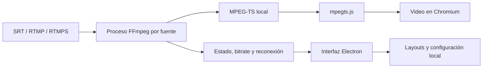

# Signal Wall

**Multiview de escritorio para monitorear señales SRT, RTMP y RTMPS con baja latencia.**

Signal Wall convierte varias señales de contribución en un muro de monitoreo configurable. Permite crear layouts de hasta `4×4`, arrastrar fuentes a cualquier espacio, guardar distintos muros y compartir un multiview completo mediante un archivo `.signalwall`.

> Estado del proyecto: versión **0.3.3** para **Windows 10/11**. NDI® está contemplado para una integración futura, pero todavía no está implementado.

## Contenido

- [¿Para qué sirve?](#para-qué-sirve)
- [Funciones principales](#funciones-principales)
- [Requisitos](#requisitos)
- [Instalación para usuarios](#instalación-para-usuarios)
- [Primer uso](#primer-uso)
- [Crear y compartir un multiview](#crear-y-compartir-un-multiview)
- [Configurar señales](#configurar-señales)
- [Perfiles de video](#perfiles-de-video)
- [Arquitectura](#arquitectura)
- [Desarrollo](#desarrollo)
- [Pruebas](#pruebas)
- [Solución de problemas](#solución-de-problemas)
- [Seguridad y privacidad](#seguridad-y-privacidad)
- [Limitaciones actuales](#limitaciones-actuales)
- [Licencia](#licencia)

## ¿Para qué sirve?

Signal Wall está pensado para operadores, canales, radios, productoras, centros de monitoreo y equipos técnicos que necesitan observar varias señales en una sola pantalla.

Algunos usos habituales:

- Monitoreo de enlaces SRT provenientes de estudios o unidades móviles.
- Supervisión de señales RTMP/RTMPS.
- Control de continuidad de varios canales.
- Muro de contribución para televisión, radio con video o streaming.
- Preparación de layouts que puedan compartirse con otro operador.

## Funciones principales

- Entradas **SRT**, **RTMP** y **RTMPS**.
- Layouts fijos `1×1`, `2×2`, `3×3` y `4×4`.
- Biblioteca lateral de fuentes.
- Arrastre de señales a cualquier espacio del multiview.
- Movimiento e intercambio de señales entre espacios.
- Retiro de una señal del muro sin eliminarla de la biblioteca.
- Varios multiviews guardados con nombre propio.
- Guardado automático y guardado manual.
- Exportación e importación de archivos `.signalwall`.
- Restauración del tamaño, señales y posiciones exactas al importar.
- Asociación de archivos `.signalwall` para abrirlos con doble clic.
- Inicio y detención individual o conjunta de las señales asignadas.
- Reconexión automática con espera progresiva.
- Bitrate aproximado y estado por fuente.
- Audio exclusivo por panel para evitar que varias fuentes suenen al mismo tiempo.
- Aislamiento de una señal mediante doble clic.
- Perfiles de transcodificación equilibrado, rendimiento y copia directa.
- Selección manual de `ffmpeg.exe`.
- Interfaz de alto contraste con estética de control maestro retro.
- Video limpio, sin scanlines ni filtros visuales sobre la señal.

## Requisitos

### Para utilizar la aplicación

- Windows 10 u 11 de 64 bits.
- FFmpeg instalado o disponible como ejecutable local.
- Un build de FFmpeg que incluya soporte para `libsrt`.
- Acceso de red a las direcciones y puertos de las señales.

FFmpeg no está incluido en el instalador. Para comprobar que reconoce los protocolos necesarios, abre PowerShell y ejecuta:

```powershell
ffmpeg -hide_banner -protocols | Select-String 'srt|rtmp'
```

La salida debe incluir al menos `srt` y `rtmp`.

### Para desarrollo

- Node.js 22 o superior.
- npm.
- FFmpeg para las pruebas reales de streaming.

## Instalación para usuarios

1. Abre la sección **Releases** del repositorio.
2. Descarga el archivo `Signal Wall Setup x.y.z.exe` de la versión más reciente.
3. Cierra cualquier versión anterior de Signal Wall.
4. Ejecuta el instalador y selecciona la carpeta de destino.
5. Inicia Signal Wall.
6. Si FFmpeg no se detecta automáticamente, abre **Configuración** y selecciona `ffmpeg.exe`.

El instalador todavía no posee firma digital. Windows SmartScreen puede mostrar una advertencia de editor desconocido. Verifica que el archivo provenga de la sección Releases de este repositorio antes de ejecutarlo.

Las actualizaciones conservan las fuentes y multiviews guardados en el perfil del usuario.

## Primer uso

1. Pulsa **Nueva fuente**.
2. Escribe un nombre para identificar la señal.
3. Introduce la URL SRT, RTMP o RTMPS.
4. Selecciona la latencia y el perfil de video.
5. Guarda la fuente.
6. Arrástrala desde la biblioteca izquierda hacia un espacio del muro.
7. Pulsa **Iniciar todo** o inicia la señal desde su panel.

Para escuchar una fuente, utiliza el botón de audio de su panel. Al activar otra, la anterior se silencia automáticamente.

## Crear y compartir un multiview

### Crear un layout

1. Pulsa **Nuevo**.
2. Escribe el nombre del multiview.
3. Selecciona `1×1`, `2×2`, `3×3` o `4×4`.
4. Pulsa **Crear multiview**.
5. Arrastra las señales a los espacios deseados.
6. Pulsa **Guardar** para confirmar el diseño.

El selector situado sobre el muro permite cambiar entre los distintos multiviews guardados.

### Exportar

Pulsa **Exportar** para crear un archivo con extensión `.signalwall`. El archivo contiene:

- Nombre del multiview.
- Tamaño exacto del layout.
- Posición de cada señal.
- Nombre y configuración de las señales asignadas.
- URLs completas necesarias para conectarse.

Sólo se incluyen las señales colocadas en ese multiview; las demás fuentes de la biblioteca no se exportan.

### Importar en otro equipo

La otra persona debe:

1. Instalar Signal Wall y configurar FFmpeg.
2. Pulsar **Importar** y seleccionar el archivo `.signalwall`, o abrirlo con doble clic.
3. Iniciar las señales.

Signal Wall recreará el mismo layout y ubicará las señales en sus posiciones originales. El segundo equipo debe tener acceso de red a las URLs incluidas en el archivo.

> **Importante:** un archivo `.signalwall` puede incluir usuarios, contraseñas, stream keys o passphrases presentes en las URLs. Compártelo únicamente con personas de confianza.

## Configurar señales

### SRT en modo caller

```text
srt://192.168.1.20:9000?mode=caller&streamid=canal-1
```

### SRT en modo listener

```text
srt://0.0.0.0:9000?mode=listener
```

### RTMP

```text
rtmp://servidor.example.com/live/clave-del-stream
```

### RTMPS

```text
rtmps://servidor.example.com/live/clave-del-stream
```

Los parámetros escritos en la URL se conservan. En modo listener, comprueba que el puerto esté disponible y permitido por el Firewall de Windows.

## Perfiles de video

| Perfil | Uso recomendado | Características |
| --- | --- | --- |
| **Equilibrado** | Uso general | Transcodifica hasta 960 px y prioriza compatibilidad. Es la opción recomendada. |
| **Rendimiento** | Muchos paneles o equipos con menos recursos | Reduce la salida hasta 640 px para disminuir el consumo. |
| **Directo** | Señales H.264/AAC compatibles | Evita transcodificar, pero requiere cabeceras H.264 SPS/PPS disponibles y repetidas. |

Si el modo Directo recibe datos pero no produce un cuadro decodificable, Signal Wall puede recuperar la fuente utilizando el perfil Equilibrado.

## Arquitectura



Cada entrada se procesa de forma independiente. FFmpeg entrega una salida MPEG-TS a un servidor local y `mpegts.js` la reproduce dentro de Chromium. El proceso principal administra estados, reconexiones, almacenamiento e IPC con la interfaz.

### Estructura del proyecto

```text
signal-wall/
├── scripts/                 # Compilación y pruebas de streaming
├── src/
│   ├── renderer/            # HTML, CSS y lógica de la interfaz
│   ├── config-store.js      # Persistencia y migraciones
│   ├── ffmpeg.js            # Argumentos y detección de FFmpeg
│   ├── main.js              # Proceso principal de Electron e IPC
│   ├── multiview-model.js   # Layouts, posiciones e importación/exportación
│   ├── source-model.js      # Validación de fuentes
│   ├── stream-manager.js    # Ciclo de vida y reconexión
│   └── stream-server.js     # Salida MPEG-TS local
├── test/                    # Pruebas automatizadas
├── package.json
└── README.md
```

## Desarrollo

Después de clonar el repositorio, entra en la carpeta del proyecto e instala las dependencias:

```powershell
cd signal-wall
npm ci
```

Inicia la aplicación:

```powershell
npm start
```

El modo de desarrollo puede ejecutarse con:

```powershell
npm run dev
```

### Scripts disponibles

| Comando | Descripción |
| --- | --- |
| `npm run build:renderer` | Compila el JavaScript del renderer con esbuild. |
| `npm start` | Compila la interfaz e inicia Electron. |
| `npm run dev` | Inicia Electron con el indicador de desarrollo. |
| `npm test` | Ejecuta las pruebas automatizadas. |
| `npm run smoke:stream` | Ejecuta una prueba real del flujo SRT. |
| `npm run verify:configured` | Verifica una señal configurada. |
| `npm run pack` | Genera una carpeta ejecutable sin instalador. |
| `npm run dist` | Genera el instalador NSIS para Windows. |

Para crear el instalador:

```powershell
npm run dist
```

Electron Builder coloca los artefactos en su directorio de salida. No publiques `node_modules`, perfiles de prueba ni configuraciones locales.

## Pruebas

Ejecuta todas las pruebas unitarias con:

```powershell
npm test
```

Las pruebas cubren:

- Validación de URLs y protocolos.
- Normalización de perfiles y latencia.
- Construcción de argumentos FFmpeg.
- Creación, redimensionamiento y asignación de layouts.
- Movimiento e intercambio de señales.
- Exportación exacta del layout y sus fuentes asignadas.
- Validación de archivos `.signalwall`.
- Migración de configuraciones anteriores.

La prueba de streaming necesita FFmpeg con soporte SRT:

```powershell
npm run smoke:stream
```

## Datos y configuración

En Windows, la configuración del usuario se guarda normalmente en:

```text
%APPDATA%\signal-wall\config.json
```

Allí se almacenan las fuentes, los layouts, la ruta de FFmpeg y otras preferencias. No agregues ese archivo al repositorio ni lo compartas públicamente.

## Solución de problemas

### La señal figura “En vivo”, pero el video está negro

“En vivo” confirma que FFmpeg recibe datos, no necesariamente que Chromium haya decodificado un cuadro. Prueba lo siguiente:

1. Cambia el perfil a **Equilibrado**.
2. Comprueba que el emisor entregue H.264 y audio compatible.
3. Configura el codificador para repetir SPS/PPS o cabeceras H.264.
4. Reduce temporalmente la cantidad de señales activas.
5. Revisa el mensaje de error mostrado en el panel.

### FFmpeg no está disponible

1. Confirma que `ffmpeg.exe` funciona desde PowerShell.
2. Abre **Configuración** en Signal Wall.
3. Pulsa **Seleccionar ffmpeg.exe**.
4. Selecciona el ejecutable correcto.

### Una señal SRT no conecta

- Verifica IP, puerto, modo caller/listener y `streamid`.
- Comprueba el Firewall de Windows.
- Asegúrate de que un solo proceso use el puerto listener.
- Confirma que ambos extremos utilicen parámetros compatibles de latencia y cifrado.

### El equipo consume demasiada CPU

- Utiliza el perfil **Rendimiento**.
- Reduce el layout o detén señales que no estés monitoreando.
- Evita activar simultáneamente fuentes que no estén asignadas al muro actual.

### El instalador muestra SmartScreen

El instalador no está firmado digitalmente. Descárgalo únicamente desde Releases y verifica la procedencia antes de autorizar su ejecución.

## Seguridad y privacidad

- Las URLs se almacenan localmente en el archivo de configuración.
- Las credenciales incluidas dentro de una URL no se cifran actualmente.
- Los archivos `.signalwall` contienen las URLs de las señales exportadas.
- No publiques configuraciones reales, claves de transmisión ni passphrases.
- Para una distribución comercial se recomienda utilizar Windows Credential Manager u otro almacén seguro de secretos.

## Limitaciones actuales

- Sólo se genera instalador para Windows.
- El layout máximo es `4×4`.
- FFmpeg debe instalarse por separado.
- El instalador no tiene firma digital.
- NDI® todavía no está integrado.
- No existe administración remota ni sincronización en la nube.
- Las credenciales se almacenan localmente sin cifrado adicional.

## NDI®

La arquitectura permite añadir NDI como adaptador nativo, pero su implementación requiere el SDK oficial, sus binarios y el cumplimiento de las condiciones de distribución y marca correspondientes.

NDI® es una marca registrada de Vizrt NDI AB.

## Licencia

Este repositorio todavía no incluye una licencia de código abierto y el paquete está marcado como `UNLICENSED`. La publicación del código en GitHub no concede automáticamente permiso para copiarlo, modificarlo o redistribuirlo.

Antes de aceptar contribuciones o permitir reutilización pública, agrega una licencia compatible con el objetivo del proyecto.
